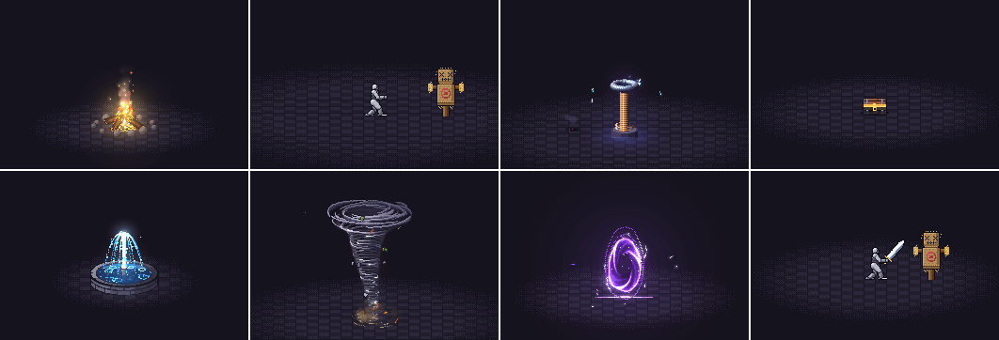

<p align="center">
  
</p>

# dotspace.

**<!-- count -->248<!-- /count --> pixel art effects and animations, in 2D and 3D, every one a small piece of code.**
Fire, explosions, magic, weather, UI, pickups, critters and more. Play them live, recolor and mirror them, turn the
camera round the 3D ones, drop them into a browser game, or export sprite sheets, directional views and lighting
maps for any engine. Plus a Claude Code skill that makes new ones the way a picky pixel artist would: draft, render,
look, refine.

**3D is pixel art too.** A 3D effect draws in world space through a camera, with a depth for every pixel, onto the
same pixel grid with the same palettes and dither. A ring on the floor is a true circle from any side, a slash really
goes behind the body and comes back in front, a meteor falls out of the distance in perspective.

**[open the gallery](https://seuput0705.github.io/dotspace/)** · [catalog](docs/CATALOG.md) · [3D](#3d) ·
[acting](#acting) · [the skill](#the-skill) · [make your own](#make-your-own) · [how it works](#how-it-works)

dotspace grew out of [pixelfx](https://github.com/patch-gg/pixelfx) by Patch, which built the 2D library, the acting
system and the tools on [Hugo Duprez](https://x.com/HugoDuprez)'s method from [How to make (good) pixel art effects
with Claude](https://www.spritefusion.com/blog/how-to-make-good-pixel-art-effects-with-claude): code is clay, trust
your eyes, feed your references. His [open-source effects](https://www.spritefusion.com/pixel-art-vfx) at Sprite Fusion
set the bar, and `src/core/sim.js` and the effects that say so at the top adapt his code. dotspace adds the third
dimension.

## what's in it.

<!-- catalog -->
| category | effects | some of them |
|---|---|---|
| **3d** | 4 | meteor, orbit orbs, shockwave, whirlwind |
| **moves** | 12 | arrow shot, dash strike, earth stomp, fireball throw, ground pound, holy smite… |
| **fire** | 12 | brazier, campfire, candle, fire breath, fire ring, fire tornado… |
| **explosions** | 12 | barrel explosion, big explosion, cartoon pow, dirt explosion, firework burst, firework rocket… |
| **water** | 12 | bubbles, drip, fountain, geyser, rain splash, ripples… |
| **ice** | 10 | blizzard vortex, freeze, frost breath, frost nova, ice crystal, ice lance… |
| **lightning** | 11 | ball lightning, chain lightning, charge up, electrified, lightning strike, plasma ball… |
| **sci-fi** | 12 | emp blast, energy core, force field, glitch, hologram, jetpack… |
| **melee** | 12 | claw swipe, dagger flurry, double slash, hammer smash, heavy cleave, scythe reap… |
| **impacts** | 11 | blunt hit, bullet impact, critical hit, ground slam, heavy landing, hit flash… |
| **projectiles** | 13 | arrow, bullet tracer, cannon shot, energy disc, signal flare, homing missile… |
| **spawn & death** | 10 | coin drop, disintegrate, dissolve burn, egg hatch, poof, respawn beam… |
| **arcane** | 12 | arcane beam, arcane missiles, arcane orb, blink in, blink out, magic circle cast… |
| **holy** | 10 | blessing, divine shield, feather burst, halo, heal, healing ring… |
| **shadow** | 12 | black hole, curse, dark explosion, eclipse, grasping hands, hex sigil… |
| **status** | 13 | bleeding, burning, charmed, confused, cursed, frozen… |
| **nature** | 13 | acid splash, boulder, earth spike, healing bloom, leaf storm, poison cloud… |
| **weather** | 12 | aurora, blizzard, cherry blossoms, clouds, falling leaves, fireflies… |
| **ui** | 12 | achievement, coin collect, combo counter, confetti, countdown, crit number… |
| **pickups** | 11 | chest open, coin spin, collect burst, crystal shard, gem spin, heart pickup… |
| **transitions** | 10 | blinds, burn away, crt off, diamond wipe, glitch wipe, iris… |
| **critters** | 12 | bat, bird, butterfly, eyeball, fish school, flying skull… |
<!-- /catalog -->

Every effect is a file in `src/fx/<category>/<name>.js`. The [catalog](docs/CATALOG.md) lists them all.

<p align="center">
  
</p>

## use one.

**In a browser game** (canvas, Phaser, PixiJS, Kaplay, three.js), use the code. No dependencies.

```js
import { createFrame, clearFrame, createFx, composite } from "dotspace";
import * as frostNova from "dotspace/fx/ice/frost-nova";

const frame = createFrame(320, 180);                   // your game's pixel resolution
const img = new ImageData(320, 180);
const fx = createFx(frostNova, { x: 160, y: 140 });   // also: flip, angle, seed, palette, light, camera...

function tick(dt) {
  fx.update(dt);
  clearFrame(frame);
  fx.draw(frame, "back");                              // behind characters
  drawCharacters();
  fx.draw(frame, "front");
  composite(frame, img.data, backgroundColor);         // color, then light added on top
  ctx.putImageData(img, 0, 0);                         // scale up with image-rendering: pixelated
}
```

Install from GitHub with `npm i github:SeuPut0705/dotspace`, or copy `src/core` and the effects you want.

**In any engine** (Godot, Unity, GameMaker, Defold, LÖVE, Bevy), use sprite sheets:

```bash
node tools/render.mjs ice/frost-nova --sheet
```

That writes a transparent PNG of every frame in a grid and an Aseprite-style JSON (frame rects, durations, and
`meta.dotspace` with fps, loop, columns and the pivot). Phaser's atlas loader and the Aseprite importers for Godot
and Unity read it. `node tools/sheets.mjs` exports the whole library to `sheets/`.

Any effect takes a `palette` (a dark-to-bright ramp of hex colors), so a fire can burn blue and a heal can glow
pink without touching its code:

```bash
node tools/render.mjs fire/torch --gif --opts '{"palette": ["#102","#215","#43a","#8cf","#cff","#fff"]}'
```

## 3d.

A 3D effect has a `camera` in its meta and draws through a Space: world coordinates (x right, y down, z towards
the viewer), a depth for every pixel, rings and slashes on any plane, shaded balls, particles and debris that fly in
all three axes.

```js
import { space, lit, fit, PAL } from "dotspace";

export const meta = { name: "Orbit", /* ... */ camera: { pitch: 0.3 }, options: { palette: PAL.arcane } };

export function draw(p, t, o) {
  const q = space(p, o), C = fit(o.palette, 8), a = (t / meta.duration) * Math.PI * 2;
  q.ring(0, 0, 0, 16, 1, C[4]);                                   // a true circle on the floor
  q.ball(Math.cos(a) * 14, -20, Math.sin(a) * 14, 3, lit(C));     // goes behind the character and back in front
  q.glow(Math.cos(a) * 14, -20, Math.sin(a) * 14, 12, C[5], 0.4);
}
```

**See it from every side.** `node tools/render.mjs 3d/shockwave` writes `views.png` (8 directions) next to the contact
sheet, `--yaw 90 --pitch 40 --dist 260` picks a camera, `node tools/orbit.mjs 3d` circles the camera while they play,
and the gallery lets you drag a 3D effect round.

**Put it in a 3D game.**

- Live, in a JS engine: give the effect the camera's angle to it every frame with `cameraToward(dx, up, dz)` and draw the
  frame on a camera-facing quad.
- Baked, in any engine: `--sheet --views 8` writes one row per direction (`<name>@yaw45` frame tags) for a directional
  billboard.
- Lit by the scene: `--maps` adds albedo, emission, normal and depth sheets laid out like the sprite sheet. 2D effects
  get them too, so any effect here can stand in a lit 3D level.

[docs/3D.md](docs/3D.md) has the whole Space API, the depth rules and the engine recipes.

## acting.

<p align="center">
  
</p>

An effect on its own looks like a sticker. What sells a hit is the body around it: the wind-up that says something is
coming, the freeze on contact, the target rocking back, the recovery. So the effects with a character, and the 12
moves, say what the body does and when:

```js
export const act = {
  target: { x: 58 },
  poses: [
    [-0.55, GUARD],            // he starts before the effect does (t = 0 is the effect's first frame)
    [-0.3, WIND_UP],
    [0, CUT, "snap"],          // "snap" holds the last pose and jumps on the key
    [0.06, FOLLOW_THROUGH, "snap"],
    [0.86, GUARD],
  ],
  hits: [{ t: 0.06, stop: 0.14, shake: 0.18, amp: 2, push: 2.8, straw: 18 }],   // freeze for 0.14 s on contact
};
```

**Play the whole thing**, character and target included, by swapping `createFx` for `createAct`:

```js
import { createFrame, clearFrame, createAct, composite } from "dotspace";
import * as slash from "dotspace/fx/melee/sword-slash";

const act = createAct(slash, { x: 80, y: 140 });

function tick(dt) {
  act.update(dt);                                  // holds still by itself during a freeze
  clearFrame(frame);
  act.draw(frame);                                 // { body: false } and { target: false } leave them out
  composite(frame, img.data, backgroundColor);
  const [sx, sy] = act.shake;                      // throw the picture this far
  ctx.putImageData(img, sx, sy);
}
```

A 3D effect acts the same way: the body and the target stand at depth 0 and the effect sorts round them, so
`3d/whirlwind` really sweeps behind the fighter and back across the front.

**Got your own character?** The timing is plain data: read `slash.act`, or `meta.dotspace.act` in a sprite sheet's
JSON (`windup`, `recovery`, `hits` with `t` and `freeze`, `poses`). Start your own wind-up animation that long before
the effect, and stop updating everything for `freeze` seconds at each hit.

Effects drawn on the body (frost, poison, a scan line) are written against the standing character and follow him
wherever he goes: each pixel of a pose knows which pixel of the standing body it came from. `node tools/act.mjs
<id> --sheet` bakes a whole act, character included, into a sprite sheet.

The body is yours to use too: `skeleton(pose)` gives you every joint of a pose in 3D, to hang your own things on, and
`posedParts(pose)` gives you each part drawn on its own.

## the skill.

The `dotspace` skill teaches Claude Code to find, use, export and make effects, 2D and 3D. Install it as a plugin:

```
/plugin marketplace add SeuPut0705/dotspace
/plugin install dotspace@dotspace
```

or copy `skills/dotspace` into `~/.claude/skills/`. Then ask for what you want:

- "Add a frost nova to my mage's ultimate."
- "Make five takes on a coin pickup sparkle and show me the best two."
- "Make a 3D ring of blades that spins round the player, and bake it as 8-direction billboards for Godot."
- "Export the fire category with normal and emission maps so my 3D scene lights them."
- "This hit effect feels floaty. Make it punchier."

## make your own.

```bash
node tools/new.mjs arcane/my-spell       # a working starting point (--loop for a loop, --3d for 3D)
node tools/render.mjs arcane/my-spell    # records/arcane/my-spell/contact.png: look at it (and views.png in 3D)
node tools/check.mjs arcane/my-spell     # spills (from every side in 3D), seams, unseeded randomness, slow frames
```

Then go round: look at the contact sheet, fix the worst thing, render again. `--gif` and `--mp4` show the motion,
`--all` shows every frame. `node tools/act.mjs arcane/my-spell` shows an act as consecutive 12 fps steps, because motion
bugs don't show in samples. [docs/AUTHORING.md](docs/AUTHORING.md) has the contract, the drawing API and the quality
bar; [docs/3D.md](docs/3D.md) the 3D side. `node tools/serve.mjs` runs the gallery locally with your effects in it.

## how it works.

- **Two kinds of effect, no images.** Pure effects export `draw(p, t, o)`, the frame at `t` seconds from `t` alone, so
  loops tile with no seam. Simulated effects export `create(o)` and step real particles, debris and lights at 120 Hz,
  so sparks bounce and smoke rolls the same at any frame rate.
- **Two buffers, and depth when it's 3D.** `color` takes pixels: opaque, dithered or truly translucent. `light` takes
  additive glow, added on top. A 3D frame adds a depth per pixel: opaque pixels write it, translucent ones and light
  test it.
- **A camera, not a 3D engine.** A Space projects world points through yaw, pitch and optional perspective onto the
  pixel grid and hands every primitive to the 2D painter with its depth. Seen from the front, it draws exactly what
  the 2D painter would, so 2D code ports by giving it a z.
- **Seeded everything.** Every random number comes from the effect's seed, so frame 40 is the same every time.
- **Local space.** Effects draw around their own origin; the painter places, mirrors and rotates them. Directional
  effects face right. A 24×38 stock character stands in for status effects, auras and hits.
- **A real skeleton, drawn down to pixels.** The grey dummy is neutral on purpose, so the eye goes to the move and any
  effect's colors read on it. He's a 3D skeleton with fixed-length bones, rendered in a few flat tones with one clean
  ink line. So he can twist, bend and really turn round. Poses hold on 12 fps steps, the way hand-drawn sprites do,
  while particles run at full rate.
- **Same frame shape as Sprite Fusion's VFX** (`{ w, h, ox, oy, color, light }`), so both libraries can draw into
  one frame.

## license.

MIT, code and effects. Use them in anything, commercial included. dotspace builds on pixelfx by Patch (MIT), with
parts adapted from Hugo Duprez's MIT effects and from Hollow Crown's MIT source; the Galmuri font in `gallery/fonts`
is under the SIL Open Font License. See [NOTICE.md](NOTICE.md).
